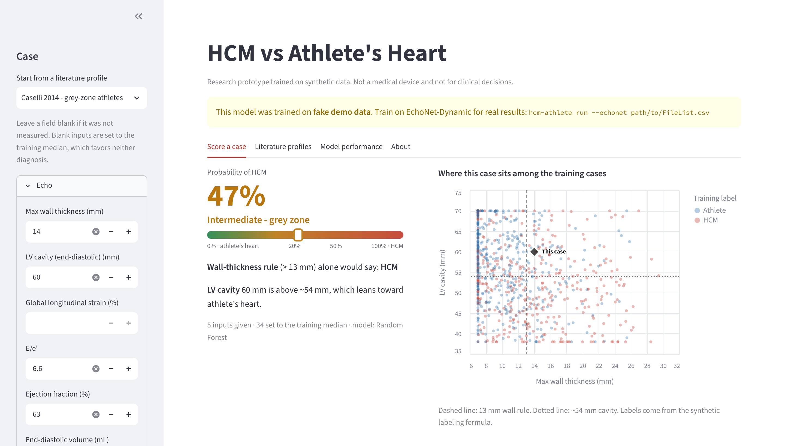
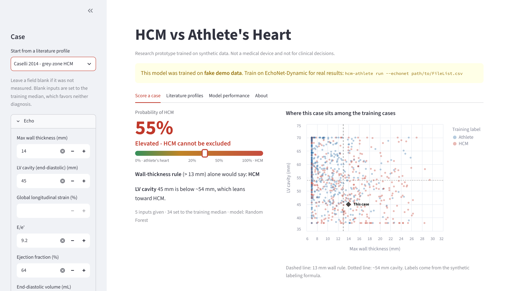

# HCM vs Athlete's Heart

[](https://colab.research.google.com/github/nav92061/Science-Fair/blob/main/notebooks/HCM_vs_Athletes_Heart.ipynb)
[](LICENSE)

A small, open machine-learning project that tries to tell **hypertrophic
cardiomyopathy (HCM)** apart from **athlete's heart**: two conditions that can
both show a thick left-ventricle wall on an echocardiogram.

The hard cases are in the "grey zone": a wall of 13-15 mm. Wall thickness alone
cannot separate them. This project tests whether adding cavity size, strain,
resting heart rate, blood pressure and troponin timing helps.

> **Not for clinical use.** The model is trained on synthetic data and has not
> been tested on real patients. It is research and teaching code, not a medical device.

<p align="center">
  
  
</p>
<p align="center"><sub>The two grey-zone groups from Caselli et al. 2014 (13-15 mm wall), using only the
values the paper reports. The wall-thickness rule calls both HCM; the model scores the HCM group
higher from cavity size and diastolic function. (Model trained on demo data, so the percentages
are illustrative only.)</sub></p>

## Why it matters

**HCM is rare, but it can kill young athletes.** It affects about 1 in 500
people (0.17% of 4,111 young adults screened by echo in the CARDIA study)<sup>1</sup>.
Among NCAA athletes, sudden cardiac death occurs about once per 53,703
athlete-years. HCM caused 8% of the deaths with a reliable autopsy<sup>2</sup>, and
6% of 357 sudden deaths in UK athletes<sup>3</sup>.

**Most thick-walled athletes are healthy.** Training thickens the heart wall too.
In 947 elite Italian athletes, 1.7% had a wall of 13 mm or more, all with the
enlarged chamber of athlete's heart<sup>4</sup>. In 3,500 elite UK athletes, 53 (1.5%)
had a 13-16 mm wall; 50 of them had an enlarged chamber, and none of the
other 3 was confirmed to have HCM<sup>5</sup>. Thicker walls are also more common in
Black athletes (18% vs 4% over 12 mm), so a wall-thickness rule flags them more
often<sup>6</sup>.

**False alarms are expensive.** A grey-zone athlete is typically sent for more
tests: a repeat echocardiogram ($188 at the 2025 Medicare rate<sup>7</sup>), cardiac
MRI, genetic testing (one commercial HCM panel lists $550-$950<sup>8</sup>), and
sometimes several weeks of stopping training to see if the wall thins<sup>5, 9</sup>.
In a UK program that screened about 5,000 young athletes, follow-up testing
of positive screens meant each serious diagnosis cost $28,500-$36,000,
depending on the screening criteria<sup>10</sup>. And under the 2015 US eligibility
recommendations, athletes with probable HCM were advised against most
competitive sports<sup>11</sup>. The 2024 HCM guideline replaced blanket restriction with
shared decision-making<sup>12</sup>, which makes telling the two apart more important,
not less.

This project asks whether measurements beyond wall thickness (cavity size,
strain, diastolic function, heart rate, troponin timing) can separate the two
in the grey zone. A tool that did this well could mean fewer healthy athletes
sent for expensive tests or benched, without missing HCM.

<details>
<summary>Sources</summary>

1. Maron BJ, et al. Prevalence of hypertrophic cardiomyopathy in a general population of young adults. <i>Circulation</i> 1995;92:785-789.
2. Harmon KG, et al. Incidence, etiology, and comparative frequency of sudden cardiac death in NCAA athletes: a decade in review. <i>Circulation</i> 2015;132:10-19. <a href="https://www.ahajournals.org/doi/10.1161/circulationaha.115.015431">doi</a>
3. Finocchiaro G, et al. Etiology of sudden death in sports: insights from a United Kingdom regional registry. <i>J Am Coll Cardiol</i> 2016;67:2108-2115.
4. Pelliccia A, et al. The upper limit of physiologic cardiac hypertrophy in highly trained elite athletes. <i>N Engl J Med</i> 1991;324:295-301.
5. Basavarajaiah S, et al. Prevalence of hypertrophic cardiomyopathy in highly trained athletes: relevance to pre-participation screening. <i>J Am Coll Cardiol</i> 2008;51:1033-1039.
6. Basavarajaiah S, et al. Ethnic differences in left ventricular remodeling in highly-trained athletes. <i>J Am Coll Cardiol</i> 2008;51:2256-2262.
7. American Society of Echocardiography. CY2026 Medicare Physician Fee Schedule final rate comparison (CPT 93306). <a href="https://www.asecho.org/wp-content/uploads/2025/11/ASE-CY2026-MPFS-Final-Rate-Comparison.pdf">pdf</a>
8. Revvity. Hypertrophic Cardiomyopathy Panel (D4103), list price, accessed November 2026. <a href="https://revvity.com/test/Hypertrophic-Cardiomyopathy-Panel-D4103">link</a>
9. Pelliccia A, et al. Remodeling of left ventricular hypertrophy in elite athletes after long-term deconditioning. <i>Circulation</i> 2002;105:944-949.
10. Dhutia H, et al. Cost implications of using different ECG criteria for screening young athletes in the United Kingdom. <i>J Am Coll Cardiol</i> 2016.
11. Maron BJ, et al. Eligibility and disqualification recommendations for competitive athletes with cardiovascular abnormalities: Task Force 3. <i>Circulation</i> 2015;132:e273-e280.
12. Ommen SR, et al. 2024 AHA/ACC/AMSSM/HRS/PACES/SCMR guideline for the management of hypertrophic cardiomyopathy. <i>Circulation</i> 2024;149:e1239-e1311. <a href="https://www.acc.org/latest-in-cardiology/ten-points-to-remember/2024/05/06/15/12/2024-hypertrophic-cardiomyopathy-gl">summary</a>

</details>

## What it does

1. **Builds a synthetic dataset.** It takes real EF/EDV/ESV values from
   [EchoNet-Dynamic](https://echonet.github.io/dynamic/) and adds strain,
   cavity, blood pressure and troponin values drawn from distributions based on
   published cohort summaries. A CTGAN then samples new cases from this seed set.
2. **Compares models.** It trains Logistic Regression, Random Forest, Gradient
   Boosting and SVM on 800 cases, tests them on 200 held-out cases, and compares
   them with the wall-thickness > 13 mm rule. You get test AUC, sensitivity,
   specificity, and 5-fold cross-validated AUC.
3. **Runs a literature sanity check.** It scores six profiles built only from
   values reported in published studies, including a grey-zone pair from the
   same study (13-15 mm wall) that differ in cavity size and diastolic function.
4. **Scores one case.** Give it any subset of measurements in a JSON file and it
   prints P(HCM) with a short report.
5. **Web app.** Enter measurements or pick a literature profile, and see P(HCM),
   what the wall-thickness rule would say, and where the case sits among the
   training cases. Tabs show the literature profiles and model performance.

## Quick start

```bash
git clone https://github.com/nav92061/Science-Fair.git
cd Science-Fair
pip install -e ".[ctgan,app]"   # [ctgan] for CTGAN, [app] for the web app
```

Try it without the dataset (fake EF/EDV/ESV, quick sampler, about 30 s):

```bash
hcm-athlete run --demo --synth bootstrap
```

Full run with EchoNet and CTGAN (a few minutes on CPU):

```bash
hcm-athlete run --echonet path/to/EchoNet-Dynamic/FileList.csv
```

Score a single case with the model you just trained:

```bash
hcm-athlete predict examples/grey_zone_athlete.json
```

```
HCM vs athlete's heart - model output
============================================
P(HCM): 16%   [Low - athlete's heart more likely]
...
Notes:
  - LV cavity 60 mm is above ~54 mm, which leans toward athlete's heart.
```

(Output from a demo-data run. Your numbers will differ.)

Open the web app (uses `results/model.joblib`; if there is none, it offers to
train a quick demo model):

```bash
hcm-athlete app
```

Or use the [Colab notebook](notebooks/HCM_vs_Athletes_Heart.ipynb), which reads
`FileList.csv` from your Google Drive.

### Outputs (in `results/`)

| File | Contents |
|---|---|
| `model_comparison.csv` | Test AUC, accuracy, sensitivity, specificity and CV AUC for each model and the baseline |
| `literature_profiles.csv` | Expected vs predicted for the six literature profiles |
| `feature_importance.csv` / `.png` | Permutation importance for the best model |
| `roc_curves.png` | ROC curves, with the wall-thickness rule as a point |
| `model.joblib` | The best model, used by `hcm-athlete predict` and the app |
| `summary.json` | Everything above plus the run settings and data source |
| `synthetic_cases.csv` | The 1,000 labeled synthetic cases |

## Data

EchoNet-Dynamic is released by Stanford under a research use agreement, so it is
**not included** here and must not be committed. Request access at
<https://echonet.github.io/dynamic/>, then pass `--echonet PATH` or set
`ECHONET_FILELIST`. Only the EF, EDV and ESV columns are used.

Every run records its data source in `summary.json`. If it says `demo`, the
results are not real.

## How it works

```
EchoNet EF/EDV/ESV ──► 1,500 seed cases ──► CTGAN ──► 1,000 cases ──► HCM score ──► labels
                       (500 HCM, 500 athlete,          (no labels)    (weighted
                        500 normal; synthetic                          sigmoids)
                        strain, cavity, BP, troponin)
                                                   ──► 800 train / 200 test ──► 4 models + baseline
                                                   ──► 6 literature profiles (sanity check)
```

There are 45 model inputs: 20 strain and diastolic, 4 standard echo, 3 geometry,
5 engineered, 7 blood pressure and 6 troponin. Only EF, EDV and ESV are real.

Full details, including the labeling formula, are in [docs/METHODS.md](docs/METHODS.md).

## Limitations

- **The training data is synthetic.** Labels come from a weighted scoring
  formula, so the models partly learn to reproduce that formula. Good test-set
  numbers show the models recovered the pattern in the synthetic data, not that
  they work on patients.
- **Labels are noisy on purpose.** Each label is drawn at random with
  probability equal to the score, so grey-zone cases stay ambiguous. AUC in the
  0.7-0.8 range is expected.
- **The six literature profiles are not a test set.** They are cohort averages,
  and the papers report only 1-5 of the model's 45 inputs; the rest are set to
  the training median. Treat them as a sanity check, not as accuracy.
- **Some generator settings are assumptions.** Values with a published source
  were checked against the papers; the rest (for example blood pressure and
  most strain values) are marked as assumptions in
  [docs/METHODS.md](docs/METHODS.md#key-generator-settings).

The obvious next step is testing on real paired echo, strain and clinical records.

## Project history

- **Jan 2026: first attempt, a CNN on echo videos.** I started by training a
  convolutional neural network directly on EchoNet-Dynamic echo videos.
  EchoNet-Dynamic labels each video with EF and volumes but not with a diagnosis,
  so there were no HCM or athlete's heart examples for a video model to learn from.
- **Jan–Feb 2026: switch to measurement features.** I rebuilt the project around
  the measurements cardiologists use in the grey zone (wall thickness, cavity
  size, strain, diastolic function, resting heart rate, troponin timing), with
  synthetic values based on published cohorts. This is the version I entered in
  my science fair, built in a Colab notebook (kept in `notebooks/archive/`).
- **Oct 2026: this version.** Cleaned up the code and documentation for sharing:
  a tested Python package, a web app, fixes to how derived features and
  cross-validation are handled, and a check of every literature value against
  the original papers.

## Project layout

```
src/hcm_athlete/
  data.py         load EchoNet FileList.csv (or demo data)
  generate.py     seed-case generators: strain, cavity, BP, troponin
  synth.py        CTGAN or bootstrap sampling, noise, physiological limits
  labeling.py     weighted HCM score and probabilistic labels
  features.py     the 45 inputs and engineered features
  model.py        model comparison, baseline, importance, saved model
  literature.py   the six literature profiles
  report.py       one-case text report
  pipeline.py     end-to-end run
  app.py          Streamlit web app
  cli.py          `hcm-athlete run` / `predict` / `app`
tests/            pytest suite (runs in about a minute, no dataset needed)
notebooks/        Colab notebook; archive/ holds the original notebook
```

## Contributing

Contributions are welcome, especially published sources for the values that
are still assumptions, and testing on real data. See [CONTRIBUTING.md](CONTRIBUTING.md).

## License

MIT. See [LICENSE](LICENSE). The EchoNet-Dynamic dataset has its own license
and is not covered by this one.
